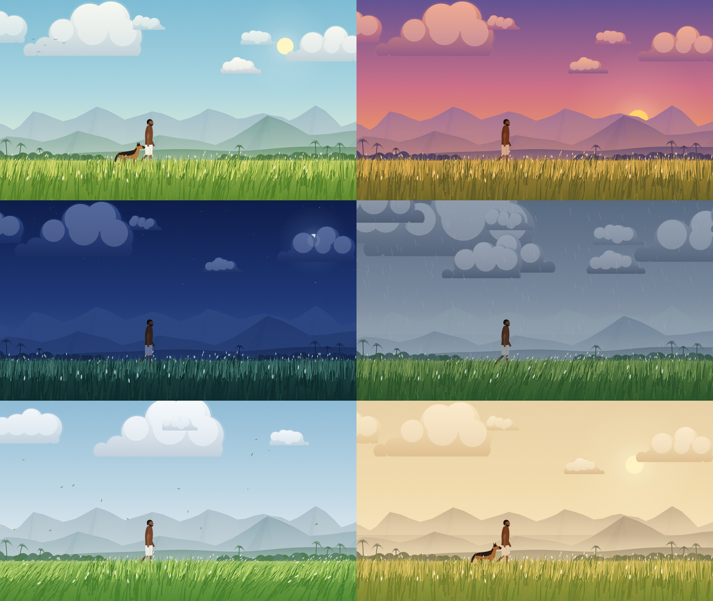

# Living Landscape

A quiet personal site. A man walks through a field in Kerala, forever.
Juhu, his German Shepherd, joins him now and then. The weather changes.

Everything is drawn in code with p5.js. No images, no sound files.



**Project docs** (PRD, UX, architecture, decisions, epics, stories): start at
[`docs/README.md`](docs/README.md).

## Run it

```bash
npm install
npm run dev
```

- Visitor view: `http://localhost:5173/`
- Tuning view: `http://localhost:5173/?dev`

Build for hosting with `npm run build`. The output is in `dist/`.

**Hosting:** GitHub Pages at https://tonyjoyk.github.io/walking-for-nothing/, deployed by `.github/workflows/deploy.yml` on
every push to `main` and every 30 minutes (to refresh Pala's weather).
Live weather is a separate opening mode, currently off (`LIVE_WEATHER` is
`false`); the deploy still refreshes Pala's weather every 30 minutes so it
can be switched back on.

Run `npm run capture` (with the dev server running) to render every scene
beside the reference sheet, the walk in both mundu states and the field
depth strip into `captures/`.

Run the regression tests with `npm test`. They render every preset, every
control extreme and several screen sizes headlessly, and check for NaN
geometry, sliding feet and paws, and config save/load.

## The dev panel

Add `?dev` to the URL to load it. Visitors never download it.

| Key | Action |
| --- | --- |
| `H` | Hide or show the panel |
| `Space` | Play or pause |

Panel groups: presets and playback, lighting and palette, clouds, field and
grass, character, Juhu, birds, weather, sound, and save and share.

Useful buttons:

- **Call Juhu now** starts her approach right away, so you can tune her gait.
- **Send birds now** spawns a flock.
- **Reset to preset** throws away your manual changes.
- **Download JSON** saves every setting. **Load JSON** restores them.
  Bad values in a loaded file are skipped and listed in the console.

### Locking in a look

When a scene looks right, export the JSON. Copy its `scene` values into
that preset in `src/config.js`, and any other changed values into
`createDefaultConfig()`. Tuning you don't export is lost on reload.

### Removing the panel

You don't need to. It only loads with `?dev`. If you want it gone:

1. Delete `src/controls/ControlPanel.js`.
2. Delete the `?dev` block at the bottom of `src/main.js`.
3. Remove `tweakpane` from `package.json`.

## How it works

```
src/
  main.js              p5 setup, resize, tab pause, sound button, ?dev loader
  config.js            six presets, defaults, control ranges, JSON validation
  audio/               recorded sound: beds per scene, birds, thunder (Web Audio)
  scene/
    Scene.js           state, parameter easing, wrap, render order, debug view
    util.js            coordinate constants, seeded random, colour helpers
    sky.js             sky gradient, sun or moon, stars
    clouds.js          painted cumulus clouds
    terrain.js         mountains with facets, hills, treeline, coconut palms
    field.js           grass: clumped blades, cached undergrowth, wind, parting
    character.js       the man: IK rig, feet, gait, pendulum arms, look, rim light
    gaitData.js        measured hip/knee/ankle curves (UCI, CC BY 4.0)
    mundu.js           the mundu as a Verlet cloth that wraps the legs
    dog.js             Juhu: state machine, IK legs, walk and trot gaits
    life.js            birds, rain, leaves, haze, mist, light, paint grain
  controls/
    ControlPanel.js    Tweakpane panel (dev only)
```

**One place, six conditions.** Each preset is the same set of keys:
colours and numbers. Changing preset eases every value toward the new one
over the transition time. Geometry never changes.

**Coordinates.** The scene is drawn in a 1920 × 1080 space. The field is
pinned to the bottom. Taller screens show more sky. Wider screens show more
land. Narrow screens show a centred slice, never less than 760 wide, so the
man stays readable.

**Seeded geometry.** Mountains, clouds, grass and palms come from a seed.
Same seed, same world. "New layout" in the grass group picks a new seed.

**Occlusion.** Grass is drawn in three bands. The far band sits behind the
man and Juhu. The mid and front bands sit in front, which hides their
lower legs.

**The field.** Each band has an undergrowth layer (staggered rows of fine
tufts) under its blades, so the ground never shows through. Undergrowth is
painted once into an offscreen bitmap per band and reused; it is redrawn
only when the view, colours or grass settings change. Blades grow in
fanned clumps, curve more towards the tip, and lean in a wind made of
noise drifting downwind, so gusts roll across in patches. Blades part
around the man's legs and Juhu's paws. Controls: **clumping** and
**undergrowth** in the grass group.

**The walk.** One phase value drives the whole body, and it advances with
distance walked, not time, so the legs can never run ahead of the ground.
The default is a slow stroll: 0.42 m steps at about 67 steps a minute, about 33
seconds per screen crossing.
- **Legs:** hip, knee and ankle follow joint angles measured from real
  walkers (`gaitData.js`), scaled to the step length. While a foot is down
  it is pinned to the ground by two-bone IK and rolls heel, flat, toe. The
  knee's small bend after heel strike sets the hip height, so the body dips
  after each contact and rises over the planted foot.
- **Arms:** driven, damped pendulums hanging from shoulders that move with
  the trunk, pulled gently towards measured arm-swing ranges. They swing
  more behind than in front, the elbow bends on the forward swing, and they
  settle to a relaxed hang when he stops.
- **Mundu:** a small Verlet cloth (five chains from the waistband) that
  collides with the legs and drapes over the seat, so the legs never show
  through above the hem. Choose folded (knee) or full (ankle) length.
- **Head and arms:** the head is one profile (skull, brow, projecting nose,
  lips, chin, jaw) with a single beard shape along the jaw and hair that
  follows the skull; inside it there is only an eye and a brow. Each arm is
  one continuous tapered shape with a smooth elbow, a small hand and a
  sleeve cut square at a rolled cuff.
- **Light:** a low sun puts a rim light on the side of the figure facing it.

The **Character** section of the dev panel has groups for body, hair,
shirt, mundu and walk: height, build, skin, hair and beard, shirt colour,
sleeve and looseness, mundu and kasavu colours, mundu length, cloth
stiffness, walking speed, steps per minute, arm swing, knee lift, bob,
and a **ground offset** that moves the man and Juhu up or down together.

**Light and shadow.** The mountains follow flat landscape illustration:
one dominant peak with smaller peaks beside it (more continue past the
frame on wide screens). Each peak's sun-facing side is a single lit plane
that fades into the haze, and distant ranges are paler with less contrast.
The man and Juhu have soft contact shadows, and long shadows that fall
across the grass when the sun is low. Grass blades darken towards their
roots.

**Field depth.** The ground offset (Character → Body) also sets how deep
the figures are in the field. Raised, the grass in front of them is short
and barely moves, so he walks on a grassy field; lowered, the hay is tall
and parts as he wades through it. **Grass parting** (Field and grass) sets
the strongest it gets.

**The mundu** has two states. **Full** reaches the ankles and hides the
legs. **Folded** is hitched up and tucked at the front, so the hem rises
towards the front and the shins show. In both, the border (dark green by
default) runs along the hem and up the edge of the outer layer, and is
drawn from the cloth's own points so it moves with it.

**Juhu.** Her states are `absent → approaching → together → departing`.
She trots to catch up, eases into a walk beside him, walks one screen width
with him, then trots ahead and leaves. She is gone for two crossings, then
returns. Her first visit comes 20 seconds after load. Her walk uses a
four-beat pattern; her trot moves diagonal legs together. Her legs use the
same IK planting as the man's, so paws stay put while they carry weight.
Her tail and ears follow her body on springs.

**Sound.** All generated, so nothing to license. Wind is shaped noise that
rises with the wind setting. Rain is filtered noise. Chirps play when a
flock enters, with a cooldown. Sound starts only after a tap on the button
in the corner.

## Opening scene and the journey

**Opening (default: shuffle).** A fresh visit opens on a random scene. Each
reload of the same tab opens on the scene after the one that was on screen,
so reloading steps through the day: Dawn → Daylight → Windy → Rain → Sunset →
Night. The tab remembers the last scene in `sessionStorage` only; nothing is
stored beyond the tab or sent anywhere. Story:
`docs/stories/1.1.shuffle-and-advance-opening.md`.

After that, each time he walks off the right and comes back in on the left,
the scene moves to the next one in the same order.

**Other opening modes** (dev panel → **Opening and journey** → opening
mode):
- **Live weather:** Kerala's time of day, easing into Pala's current weather
  from `weather.json` (`docs/product/specs/live-weather.md`). Off for now:
  - the repository variable `LIVE_WEATHER` is `false`, so the deploy
    publishes the file switched off;
  - `?weather=live` previews it.
- **Time of day:** Kerala's time of day only.

`?weather=rain` (or `sunny`, `overcast`, `wind`, `dawn`, `twilight`,
`night`) forces the opening scene. The weather rules (wind thresholds, dawn
and sunset windows, maximum age, location) are `WEATHER_RULES` in
`src/config.js`.

## The greeting

Rest the cursor on the man and he slows to a stop (always with both feet on
the ground), turns to face you head first, looks at you for 3 seconds, then
slowly smiles. Four seconds later he turns back and walks on. Move the cursor
off him at any point and he turns back straight away. On a phone, tap him.

How it works: `src/scene/greeting.js` is a small state machine that eases
his speed, stance, head and body turn, and smile. The drawing turns by
blending each profile outline (head, hair, beard, neck, shirt) into a
front-view twin with the same path commands, and by projecting arms, legs,
eyes and ears from simple 3D positions, so at turn 0 it is exactly the
profile figure. The mundu's simulated cloth morphs to its front view. Timings
and an on/off switch are in the dev panel under **Greeting** (with a "Greet
now" button); `npm run capture -- --only greet` renders the sequence. Spec:
`docs/product/specs/greeting.md`.

## Credits

Live weather: data by [Open-Meteo.com](https://open-meteo.com/), licensed
CC BY 4.0. A small credit appears on the page when the opening scene comes
from it.

Gait curves are the mean of the unbraced trials in the UCI Machine Learning
Repository "Multivariate Gait Data"
(https://archive.ics.uci.edu/dataset/760/multivariate+gait+data),
licensed CC BY 4.0. The values were averaged and rounded.

## Sound

Recorded sound plays per scene: a looping bed, one-shot birds and thunder in
the rain. The generated wind and rain fill in while recordings load. How it
plays together: `docs/bmad/party-mode/2026-10-20-sound-mix.md`.

- The recordings are listed in `audio/sources.json`. Originals go in
  `audio-src/`, which is git-ignored.
- `node scripts/build-audio.mjs` makes `public/audio/` and `manifest.json`.
- The mix, bird and thunder tables are in `src/config.js` (`AUDIO_MIX`,
  `AUDIO_EVENTS`, `AUDIO_THUNDER`).

## Notes and known limits

- The painted finish uses a generated grain overlay and gradient glows, not
  a shader. It is cheaper and works the same on every browser. A shader
  pass can come later if the look needs it.
- Mobile works but is not tuned. Quality "low" or "medium" lowers grass
  count and pixel density.
- The visitor UI is only the sound button. The site still needs a decision
  on what else a visitor finds.
