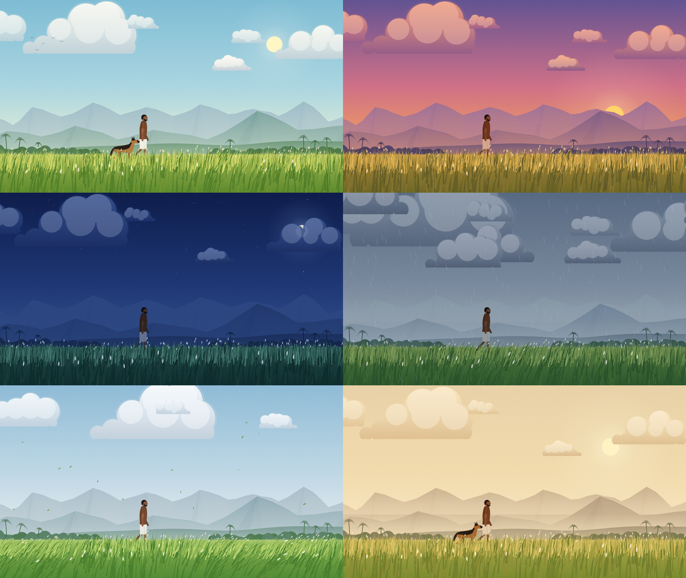

# Walking for Nothing

A quiet personal site by Tony Joy. A man in a white mundu walks through a
field in Kerala, forever. Juhu, his German Shepherd, joins him now and then.
The light and weather change as he walks.

**Live site:** https://tonyjoyk.github.io/walking-for-nothing/

The scene is drawn in code with p5.js. The sound is real, openly licensed
field recordings.



**Contents:** [What a visitor can do](#what-a-visitor-can-do) ·
[Run it](#run-it) · [Where things are](#where-things-are) ·
[How it works](#how-it-works) · [The dev panel](#the-dev-panel) ·
[Tests, captures and hosting](#tests-captures-and-hosting) ·
[Project docs](#project-docs) · [Credits](#credits) ·
[Known limits](#known-limits)

## What a visitor can do

The site has no menu and no instructions. The scene is the interface, and
everything is found by chance.

- **Watch.** He walks across the screen; each time he walks off the right
  and comes back on the left, the scene moves on: Dawn, Day, Windy, Rain,
  Sunset, Night.
- **Say hello.** Rest the cursor on him (or tap him on a phone). He stops,
  turns to face you, and a small speech bubble introduces Tony with a
  "View my work" link. It stays 9 seconds after it appears; a click or tap
  anywhere else sends him on his way.
- **Notice the hints.** A hand cursor shows over him, Juhu looks up at him
  when he's greeted, and a soft tap circle on his chest shows that he can
  be tapped (a few seconds after the sound pill, until the visitor first
  greets him).
- **Listen.** Sound starts on the first click, tap or key anywhere (browsers
  allow nothing earlier). A small "Click for sound" pill by the speaker says
  so, then fades. Turning sound off lasts for that visit only.
- **Adjust,** bottom right: the speaker (with a volume slider on hover) and
  a time-of-day menu to stay in one scene.
- **Credits,** bottom left: every recording and its licence.

## Run it

You need Node.js.

```bash
npm install
npm run dev
```

Then open:

| Address | What it shows |
| --- | --- |
| `http://localhost:5173/` | The site as visitors see it |
| `http://localhost:5173/?dev` | The site with the tuning panel |
| `?weather=rain` | Opens on a given scene (also `sunny`, `overcast`, `wind`, `dawn`, `twilight`, `night`) |
| `?ghost` | Plays the tap circle on every load (normally only until the visitor greets him) |

`npm run build` makes the hosted version in `dist/`.

## Where things are

```
index.html             the page: canvas, speech bubble, controls, credits
src/
  main.js              starts everything: p5 setup, pointer and greeting input,
                       sound, the visitor controls, ?dev loader
  config.js            the six scene presets, defaults, ranges, sound tables
  bubble.js            places the speech bubble and keeps its text readable
  ghostTap.js          the one-time tap circle on the man
  credits.js           the Credits list (bottom left)
  weather.js           live weather (switched off for now)
  scene/               everything drawn on the canvas
    Scene.js           state, easing between scenes, draw order
    character.js       the man: rig, gait, arms, turning to face you
    greeting.js        the greeting's state machine and timings
    mundu.js           the mundu as a simulated cloth
    dog.js             Juhu: when she comes and goes, her gaits
    sky.js, clouds.js, terrain.js, field.js, life.js
                       sky, clouds, hills, grass, birds, rain, lightning
    gaitData.js        measured walking curves (UCI, CC BY 4.0)
  audio/               recorded sound: beds, birds, thunder, credits
  controls/
    visitorControls.js speaker, volume, "Click for sound", time-of-day menu
    ControlPanel.js    the dev panel (only loaded with ?dev)
  styles/main.css      all page styles
public/audio/          processed recordings and manifest.json
tests/                 automated tests (npm test)
tools/capture.mjs      renders scenes to images (npm run capture)
docs/                  product, UX and architecture docs, decisions, stories
```

## How it works

**One place, six moods.** Each scene preset is the same set of colours and
numbers. Moving to a new scene eases every value toward the new one; the
geometry never changes. Mountains, clouds, grass and palms come from a seed,
so the world is the same on every visit.

**Any screen size.** The scene is drawn in a 1920 × 1080 space with the
field pinned to the bottom. Taller screens show more sky, wider ones more
land, and narrow ones a centred slice (never less than 760 wide), so the
man stays readable.

**The walk.** One phase value drives the whole body and advances with
distance walked, so his feet never slide.
- **Legs** follow joint angles measured from real walkers. A planted foot is
  pinned to the ground and rolls heel, flat, toe.
- **Arms** are damped pendulums that swing more behind than in front.
- **The mundu** is a small cloth simulation that drapes over the legs, full
  length or folded at the knee.
- **The grass** grows in clumps, sways in gusts and parts around his legs
  and Juhu's paws. The near grass is drawn in front of them, so it hides
  their feet.

**The greeting.** `greeting.js` is a small state machine:
1. After about 1.5 seconds of hover (or a tap), he stops with both feet
   down and turns to you, head first.
2. The bubble's lines fade in over about a second.
3. It holds 9 seconds, paused only while the cursor is on the bubble. A
   click or tap elsewhere ends it at once; a click on him also does.
4. He turns back and walks on.

The turn blends each profile shape into a front-view twin, so at the start
it is exactly the profile figure.

**Juhu.** She sets off from the left once he reaches the middle of the
screen, trots to catch up, and walks beside him into the next scene. Then
she trots ahead and leaves, skips two scenes, and comes back. Her paws stay
planted while they carry weight, and her tail and ears follow her body on
springs.

**The journey.** A fresh visit opens on a random scene. Reloading the same
tab opens the next one. Each crossing of the screen moves to the next scene,
unless the visitor picked one in the time-of-day menu.

**Sound.** Each scene has a looping recording (a bed), with one-off birds,
and lightning followed by thunder in Rain. Sound fades out when the page
isn't in front, and stops when the tab is hidden. The mix and event tables
are in `src/config.js` (`AUDIO_MIX`, `AUDIO_EVENTS`, `AUDIO_THUNDER`).

To change the recordings:
1. List them in `audio/sources.json` and put the originals in `audio-src/`
   (not committed).
2. Run `node scripts/build-audio.mjs`. It writes `public/audio/`,
   `manifest.json`, and the "Sound credits" list in this README.

## The dev panel

Add `?dev` to the address. Visitors never download it.

- `H` hides or shows the panel; `Space` plays or pauses.
- Groups cover presets and playback, light and colour, clouds, grass, the
  man, Juhu, birds, weather, sound and the greeting.
- Handy buttons: **Call Juhu now**, **Send birds now**, **Greet now**,
  **Reset to preset**.
- **Download JSON** saves every setting; **Load JSON** restores them.

**Keeping a look:** download the JSON, then copy its `scene` values into
that preset in `src/config.js`, and other changed values into
`createDefaultConfig()`. Anything not copied is lost on reload.

## Tests, captures and hosting

- `npm test` runs the automated tests. They draw every scene, every control
  extreme and several screen sizes without a browser, and check the walk,
  the greeting, Juhu, the sound and the controls.
- `npm run capture` (with the dev server running) renders every scene, the
  walk and the greeting into `captures/`, for checking by eye
  (`npm run capture -- --only greet` for one set).
- **Hosting:** GitHub Pages, deployed by `.github/workflows/deploy.yml` on
  every push to `main`, and every 30 minutes to refresh Pala's weather for
  when live weather is switched back on.

## Project docs

Product, UX and architecture docs, the decision log and every story live in
[`docs/`](docs/README.md). Start with
[`docs/README.md`](docs/README.md): it explains how the docs are organised,
which story and decision numbers are free, and the rules for working on the
project.

## Credits

The on-page Credits link lists every recording, plus the weather data while
live weather is on.

- **Live weather:** data by [Open-Meteo.com](https://open-meteo.com/),
  CC BY 4.0.
- **Gait curves:** the mean of the unbraced trials in the UCI Machine
  Learning Repository "Multivariate Gait Data"
  (https://archive.ics.uci.edu/dataset/760/multivariate+gait+data),
  CC BY 4.0, averaged and rounded.

### Sound credits

Every recording in `public/audio/`, from `public/audio/manifest.json`:

<!-- sound-credits:start (generated by scripts/build-audio.mjs from public/audio/manifest.json; do not edit) -->
- [Tropical Orchard in Spring](https://freesound.org/people/Calcuttan/sounds/184798/) by Calcuttan, [CC BY 4.0](https://creativecommons.org/licenses/by/4.0/); trimmed, looped and levelled. Files: `dawnOrchard` (.webm and .m4a).
- [crickets and tropical birds village or backyard day like after rain India](https://freesound.org/people/kyles/sounds/451945/) by kyles, [CC0](https://creativecommons.org/publicdomain/zero/1.0/); trimmed, looped and levelled. Files: `dayField` (.webm and .m4a).
- [Wind in the African bush (Mali)](https://freesound.org/people/felix.blume/sounds/171445/) by felix.blume, [CC0](https://creativecommons.org/publicdomain/zero/1.0/); trimmed, looped and levelled. Files: `windGrass` (.webm and .m4a).
- [Light rain in a field of bananas trees](https://freesound.org/people/felix.blume/sounds/512334/) by felix.blume, [CC0](https://creativecommons.org/publicdomain/zero/1.0/); trimmed, looped and levelled. Files: `rainSteady` (.webm and .m4a).
- [Birds to Crickets](https://freesound.org/people/deadmanswill/sounds/568216/) by deadmanswill, [CC BY 4.0](https://creativecommons.org/licenses/by/4.0/); trimmed, looped and levelled. Files: `eveningBirdsToCrickets` (.webm and .m4a).
- [Night Crickets on a Quiet Road – Goa Ambience](https://freesound.org/people/Federico_Casazza/sounds/803557/) by Federico\_Casazza, [CC BY 4.0](https://creativecommons.org/licenses/by/4.0/); trimmed, looped and levelled. Files: `nightCrickets` (.webm and .m4a).
- [210614 Thunder, dry rolling distant some big, birds, roof](https://freesound.org/people/TRP/sounds/578230/) by TRP, [CC0](https://creativecommons.org/publicdomain/zero/1.0/); cut and levelled. Files: `thunderDistant-1`, `thunderDistant-2`, `thunderDistant-3`, `thunderDistant-4`, `thunderDistant-5` (.webm and .m4a).
- [Rolling thunder closer rain drops ms](https://freesound.org/people/TRP/sounds/574386/) by TRP, [CC0](https://creativecommons.org/publicdomain/zero/1.0/); cut and levelled. Files: `thunderClose-1` (.webm and .m4a).
- [House crows](https://freesound.org/people/Calcuttan/sounds/249567/) by Calcuttan, [CC0](https://creativecommons.org/publicdomain/zero/1.0/); cut and levelled. Files: `crowsHouse-1`, `crowsHouse-2`, `crowsHouse-3` (.webm and .m4a).
- [Asian koel (Eudynamys scolopaceus)](https://xeno-canto.org/753727) by Jairam Vijayan, [CC BY-SA 4.0](https://creativecommons.org/licenses/by-sa/4.0/); cut and levelled. Files: `koel-1`, `koel-2`, `koel-3`, `koel-4` (.webm and .m4a).
- [White-throated kingfisher](https://xeno-canto.org/603361) by Sathyan Meppayur, [CC0](https://creativecommons.org/publicdomain/zero/1.0/); cut and levelled. Files: `kingfisher-1`, `kingfisher-2`, `kingfisher-3` (.webm and .m4a).
<!-- sound-credits:end -->

## Known limits

- **Live weather is paused.** It can open the site on Pala's real weather
  (`?weather=live` previews it), but it is switched off with the repository
  variable `LIVE_WEATHER`. A review of whether to remove it is due 31 Jan
  2027.
- **Mobile works but isn't tuned.** The dev panel's quality setting lowers
  grass and pixel density on slower devices.
- **The painted look** uses a grain overlay and soft gradients, not a
  shader. It's cheaper and looks the same in every browser.
